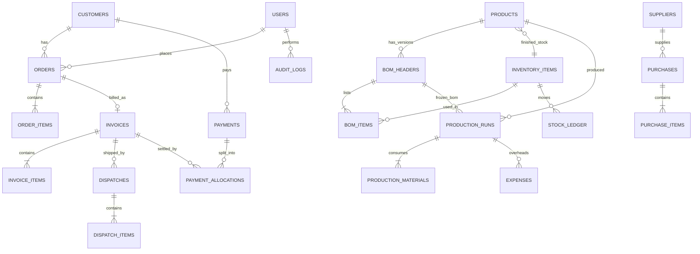

# SmartBatch 360 – Design Note

## Architecture
Flask application factory + 9 blueprints (auth, main, master, inventory, production, sales, billing, reports, intelligence).
Routes only handle HTTP; all business rules live in `app/services/*` (inventory, production, sales, reports, intelligence).
SQLAlchemy ORM (SQLite by default, MySQL via `DATABASE_URL`). Every critical operation (purchase, production, dispatch, payment) runs in one DB transaction: on any error it is rolled back.

## ER diagram

Key ideas: `stock_ledger` is the only source of stock (balance = sum(in) - sum(out)); `production_runs.bom_id` freezes the BOM version used; invoices and dispatches are separate tables; payments are linked to invoices only through `payment_allocations`.

## BOM calculation
Planned consumption = BOM qty per batch x planned batches (converted to the item's stock unit).
Material variance = actual - planned; variance % = (actual - planned) / planned x 100; yield variance % = (actual output - expected) / expected x 100. Anything above the tolerance (3 %, `VARIANCE_TOLERANCE` in `.env`) is flagged.

## Stock ledger
Opening + receipts - issues +/- adjustments = closing. Rows are never edited or deleted; corrections are new ADJUSTMENT rows with a reason. `post()` refuses any movement that would make stock negative.

## Costing method
* Raw material / packaging: **weighted average** updated on each purchase: (old qty x old cost + new qty x rate) / (old + new qty). Benchmark flour = (100x42 + 60x45)/160 = Rs 43.125/kg.
* Materials are valued at the average cost at the moment of issue.
* Pouches consumed = good packets + damaged pouches (every packet used one pouch). Cartons = actual cartons entered.
* Overheads (labour, gas/power, other) are entered per production run (no apportioning across runs).
* Cost per packet = total run cost / **good** packets. Damaged material is therefore absorbed by the good output.
* Benchmark: RM 3435 + packaging 620 + labour 1200 + power 600 = Rs 5855 / 188 = **Rs 31.14**. Alternative (FIFO flour at Rs 42 for the 40 kg issued): 5810 / 188 = Rs 30.90 - a difference of Rs 0.24 per packet.
* Money uses `Decimal` only.

## Important decisions
Invoice does not move stock; dispatch does. Posted invoices are never deleted (cancel with reason, only if no payments/dispatch). Every order edit, status change, adjustment and BOM change is written to `audit_logs`.
